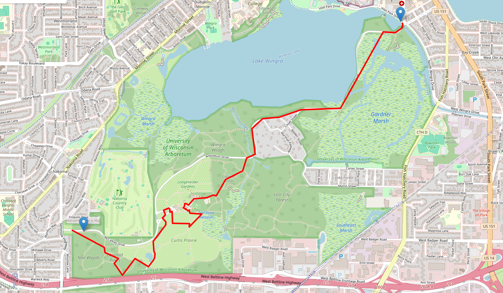

# Fantasy Trail Stitcher

A route-planning tool that generates real, walkable routes matching a target
distance, built around a custom distance-constrained pathfinding algorithm
over OpenStreetMap trail and road data.

The idea is to walk a legendary journey in real life, at its real length.
Frodo's road from Bag End to Mount Doom is 2,865km, so you walk it 5 or
10km at a time near home. Each walk covers the next stretch, progress is
saved between walks, and when a walk reaches a stop on the journey, the
route bends through a real place that matches it: Lothlórien in real
woods, the Dead Marshes in a real wetland. Underneath is the core
mechanic: given a start point, an end point (or a loop), and a target
distance, find a real route that matches, preferring trails over roads
where they exist.

## What it does

Given two points and a target distance, the system searches a real trail
and road network (pulled from OpenStreetMap) for a walkable route whose
length is close to the target, favoring trail-type paths over roads
without ever ruling roads out, since some road-walking is often necessary
to connect disconnected trail systems.

## Example

A route generated near the UW-Madison Arboretum, matching an 8,000m
target distance:



The route threads through Curtis Prairie, Longenecker Gardens, and
Gallistrom Woods before following the shoreline of Lake Wingra to
Vilas Park, mostly on real trail (footway/path), not sidewalks.

## Architecture

- **Data layer**: OSMnx pulls walkable network data from OpenStreetMap,
  cached locally as GraphML so the app never queries OSM live.
- **Pathfinding**: a custom randomized DFS with backtracking, guided by a
  Dijkstra-precomputed feasibility bound, wrapped in bounded random
  restarts. See "Algorithm design" below for why this exists.
- **API**: FastAPI loads the graph once at startup and exposes `/route`,
  `/journeys`, and endpoints for preparing other cities and nearby real
  places. It also serves the frontend.
- **Frontend**: a small Leaflet app in `static/`. Pick a journey, choose
  today's distance, click the map for a start (and finish, for one-way
  routes), and the route is drawn with any stops it reaches. "I walked it"
  adds the walk to your progress, saved in the browser.
- **Tests**: `venv/bin/python -m pytest` runs a fast suite on small
  synthetic graphs, so it doesn't need the regional GraphML.

## Running it

```
venv/bin/uvicorn api:app
```

Then open http://127.0.0.1:8000/. Startup takes about a minute while the
regional graph loads.

## Journeys

Journeys live in `journeys.py`, each with its real story length and the
distance of every stop from the start:

- **Frodo's Road**, Bag End to Mount Doom, 2,865km. Every stage is from
  Karen Wynn Fonstad's *The Atlas of Middle-earth*, measured on Tolkien's
  own maps.
- **Bilbo's Road**, Bag End to the Lonely Mountain, 1,529km (950mi). The
  total and the Rivendell stage are from LOTRProject; no published source
  gives the later stages, so those stops are estimated from the map.

A journey is walked over many outings. You pick each walk's length, and it
covers the next stretch of the journey: from 730km into Frodo's road, a
10km walk reaches Rivendell at 735km. The last walk is cut to whatever's
left.

Both journeys are from Tolkien's works, used with place names only (no
quotes, maps or art) for personal use. They are not public domain, so
replace them before publishing the app anywhere public. Public-domain
journeys considered and set aside: Oz, Alice and Jules Verne's journeys
give no walkable distance or are far too long (Around the World is about
40,000km), Sir Gawain's route has no sourced distance, and the Odyssey
measures about 4,900km between its traditionally identified places.

## Stops on real places

Each stop has a terrain: forest, water, marsh, meadow, park, town, hill,
tower, bridge or tunnel, each with fallbacks (a hill falls back to a
tower, then woods). When a walk reaches a stop, it's routed in legs
(start, through a matching real place at about the right distance, then
on to the end), with each leg a normal distance-matched search that may
not reuse a segment an earlier leg took. From the UW campus, Lothlórien
lands in Muir Woods. From the Arboretum, the Dead Marshes land in
Gardner Marsh.

Bridges and tunnels come straight from the walk network's OSM tags. The
other terrains need OSM features the walk network doesn't include
(woods, water, wetland...), downloaded in the background for about 10km
around wherever someone starts and cached to `cache/features/`. Until
they arrive, and whenever no matching place fits, a stop is placed at its
proportional point along an ordinary route instead. The page says so,
and the walk's length always wins over the stop's terrain.

## Other cities

Madison's 50-mile graph is built ahead of time. Any other US city gets
its map on demand: the frontend searches for the city (OpenStreetMap's
Nominatim, US results only), and the server pulls a walk network within
6km of it in a background thread while the page shows a "preparing" state.
Each city is pulled once and saved to `cache/regions/`, so it loads from
disk in seconds after that. Only a few pulled cities stay in memory at a
time. A city that falls inside Madison's area just uses Madison's graph.

The wait for a new city is almost all download time from the public
Overpass API, not processing: Decorah, Iowa took about 4 minutes to
arrive and under 2 seconds to build. Pulled cities support walks up to
12km, since a loop of length D can reach about D/2 from its start.

## Algorithm design: why this isn't just shortest-path

Finding *a* path between two points is trivial (Dijkstra). Finding a path
whose length matches a *target* distance is a different, harder problem,
and the path taken here to solve it is the core technical content of this
project.

**Attempt 1: k-shortest-paths.** Networkx's `shortest_simple_paths` (Yen's
algorithm) generates simple paths between two points in increasing length
order, so trying candidates until one matches the target seemed natural.
In testing, this plateaued fast: on real park trail networks, the first 50
candidate paths were barely longer than the shortest path itself. Yen's
algorithm generates alternates by taking small local deviations from the
shortest path, so reaching a path meaningfully longer than the shortest one
can require checking an impractically large number of candidates.

**Attempt 2: randomized DFS with backtracking.** Instead of enumerating
near-shortest paths, build a path incrementally: at each node, look at
unvisited neighbors, use a Dijkstra-precomputed "distance remaining to the
end" value to prune any neighbor that could never reach the destination
within the distance budget, and pick randomly among what's left. On
dead-ends, backtrack rather than discard the whole attempt. This performed
far better and could reach target distances several times the direct
shortest path.

**A hard limit, and why it's not a bug.** Even with backtracking, very
long targets between a specific pair of points sometimes failed outright.
Testing showed this wasn't fixable by pulling more map data: a much larger
regional graph (338K nodes vs. 137K) produced the same ceiling for the
same point pair. The reason is structural: the simple-path constraint (no
revisiting a node) means the longest possible route between two fixed
points isn't bounded by how much trail exists overall, it's the "longest
simple path between two nodes" problem, which is NP-hard in general. The
fix that worked was **bounded random restarts**: many short search attempts
beat one long one, since an early unlucky random choice can doom an entire
attempt.

**Trail preference without breaking feasibility.** Real OSM data pulled
for a 50-mile radius around a mid-size US city is roughly 83% road and
under 5% actual trail (path/track/bridleway), so an unweighted search
overwhelmingly finds sidewalk- and road-heavy routes. A hard trail-only
restriction was tested but rejected: trail data alone is highly
fragmented (over 3,000 disconnected components in the test region, the
largest only ~300 nodes), far too sparse to route long distances on its
own. The working solution penalizes road edges in the *selection* step
only, while keeping the *feasibility* check (can this route reach the
end within budget) based on true physical distance. Mixing the penalty
into feasibility was tried first and caused the search to falsely
conclude destinations were unreachable; separating "is this reachable"
from "which neighbor do we prefer" fixed it.

## Loop routes

Most walks start and end in the same place, so the API also supports
loops: leave out the end point and the route returns to the start.

**A different rule for "don't repeat yourself."** A loop can't be a
simple path, since it has to come back through its start. So in loop
mode the constraint changes from "never visit the same node twice" to
"never walk the same street segment twice, in either direction." Loops
can cross their own intersections (a figure-8 through a junction is
fine) but never retrace a stretch. The same DFS, feasibility bound, and
trail weighting are reused; only what counts as "already used" changes.

**The first version failed almost everywhere.** On synthetic grids it
worked immediately. On the real Madison graph, a 3km loop from an urban
start failed 5 out of 5 times. Instrumenting the search showed it never
got back to the start even once in 20,000 steps. The cause was the start
point itself: clicks snap to the nearest OSM node, which is often the tip
of a footpath or driveway stub with a single neighbor. Leave a dead end
along its only segment, and under the no-retracing rule you can never
return. Walking the stub out to the first junction didn't fix it either:
that "junction" connected the stub to a second dead-end stub, leaving one
real way out.

**Bridges.** The general version of the problem is a graph-theory
concept: a *bridge* is a segment whose removal splits the network in two.
A closed walk that never repeats a segment can never use one, since once
across there's no other way back. In this data, about a quarter of all
segments (106K of 448K) are bridges: cul-de-sacs, driveways, parking-lot
aisles, footpath stubs. The search had been wasting most of its steps
wandering into them and backtracking out. The fix has two parts:

- Bridges are found once at startup (~6s on the full graph, cached) and
  are off-limits during the loop search.
- If the start isn't on any cycle, the route takes the shortest path out
  to the nearest node that is, loops from there, and comes back the same
  way. That approach path is the one stretch a loop is allowed to repeat,
  since it's the only way in or out. The loop's target is reduced by
  twice its length, so the total still matches what was asked for.

That took the urban start from 0% to over 90% success, and helped longer
loops from trail-rich starts too.

**Restarts, again.** Same lesson as point-to-point routing, even more so:
benchmarked over 3-20km loops from an Arboretum start and an urban start,
5,000 steps x 40 restarts found a route within tolerance in 49/50 runs,
versus 41/50 for 20,000 x 10, with median latency under 0.7s even at 20km.
Loops use the shorter, more numerous attempts.

## Known limitations

- Achievable route length for a given point pair is bounded by local
  trail connectivity, not total map size; very long targets may fail even
  with restarts.
- Very long loops (20km+) occasionally come back short of the target.
  The API flags this with `within_tolerance: false` and the map says so.
- A city's first map takes minutes to prepare, depending on the public
  Overpass API's load. The API is free and shared, so heavy use of this
  app would need its own OSM data source.
- Stops can only land on places OpenStreetMap has mapped. Madison has no
  mapped peaks near most starts, so Weathertop usually falls back to
  woods, and water within reach of a short leg can be scarce.
- Progress lives in one browser's local storage: clearing site data or
  switching devices loses it, and "I walked it" is the honor system.
- Route quality (trail vs. road percentage) depends heavily on how much
  real trail exists near the chosen start/end points; urban-only requests
  will be sidewalk-heavy by nature of the underlying data.
- Data is pre-fetched and cached per region rather than queried live, since
  the public OSM Overpass API cannot reliably serve large-radius requests
  in a single call (confirmed via testing: a 50-mile single-request pull
  timed out after 10 minutes). The current region (Madison, WI, 50-mile
  radius) was built from 25 overlapping tiled requests merged into one
  graph.

## Stack

Python, OSMnx, NetworkX, FastAPI, Leaflet.